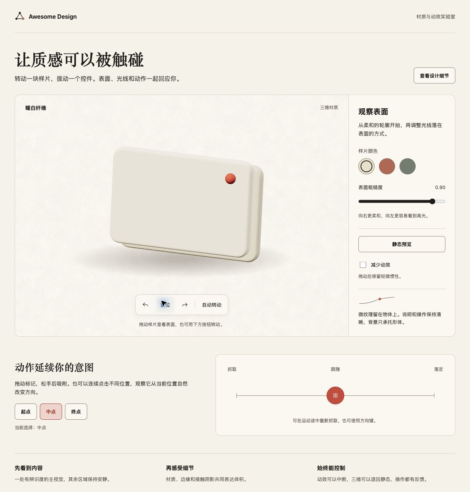

# Awesome Skills

可复用的个人 Agent Skills。用最少必要上下文，帮助 Agent 在真实任务中做出正确判断并交付可用结果。

## 技能

| Skill | 用途 |
| --- | --- |
| [awesome-design](skills/awesome-design/SKILL.md) | 设计与打磨 Web/GUI：暖纸纤维、清晰排版、克制配色、工作台、交互动画及 Three.js 材质。 |

`awesome-design` 保持一条统一的审美主线：温润的表面、清楚的信息层级、单一品牌强调色、稳定空间关系和有因果的微反馈。它提供可执行的设计方法、CSS token、原创纹理、二维图解与三维交互样本。



## 使用

将所需的完整技能目录复制到你使用的 Agent 的技能目录，或让支持 GitHub Skill 安装的工具从本仓库的 `skills/awesome-design` 安装。保留目录中的 `references/`、`assets/` 等相对结构。

示例请求：

> 使用 awesome-design 设计并实现当前网页。保留暖纸与清晰的信息层级，按任务需要打磨 CSS 材质、图形和可中断动效。

## 查看交互样本

克隆仓库，在根目录启动本地静态服务：

```bash
git clone https://github.com/VincentLin94/awesome-skills.git
cd awesome-skills
python3 -m http.server 8766 --bind 127.0.0.1 --directory skills/awesome-design/assets
```

在浏览器访问 `http://127.0.0.1:8766/specimen.html`，查看配色、图解、筛选和收藏示例。它无需安装依赖。

材质与动效实验室另需安装其声明的 Three.js 依赖：

```bash
npm --prefix skills/awesome-design/assets/web-lab ci --ignore-scripts
```

然后访问同一服务的 `http://127.0.0.1:8766/web-lab/`。可调整材质与粗糙度、拖动旋转、切换静态替代、操作吸附控件和减少动效。依赖在安装后从本机加载；`node_modules` 不进入仓库。

## 开发与维护

开发原则见 [AGENTS.md](AGENTS.md)，技能发现与版本记录见 [registry.json](skills/registry.json)。规约从作者已有技能仓库的主分支迁移，并按本仓约定明确：

- 只更新实际变更 Skill 的版本和 changelog，无关 Skill 不联动递增。
- SkillGuard 不是必要检查或依赖。
- 通过真实任务、实际交互和产物审查检验效果，保持主文件精简、参考按需加载。
- 临时报告、测试过程、依赖缓存与输出留在本地；`output/` 内容默认不提交。

## 许可与来源

原创内容采用 [MIT License](LICENSE)。`awesome-design` 的部分设计方法依据用户提供的 `frontend-design` 指引改写，相关部分保留 [Apache-2.0 许可](skills/awesome-design/references/licenses/Apache-2.0.txt)；Three.js 按其包内 MIT LICENSE 使用。公开视觉与技术依据见 [来源记录](skills/awesome-design/references/sources.md)。

参考文章的原始图片、私有项目源码和品牌资产不随仓库分发。
