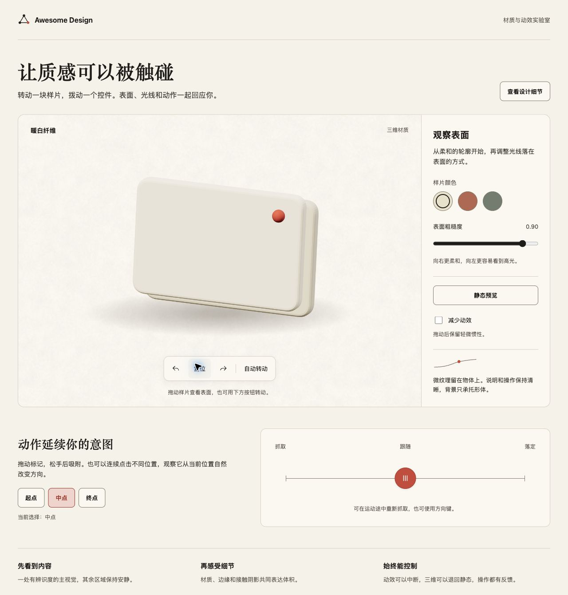
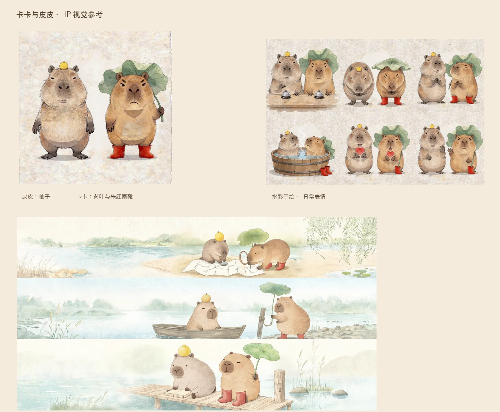

# Awesome Skills

可复用的个人 Agent Skills。用最少必要上下文，帮助 Agent 在真实任务中做出正确判断并交付可用结果。

## 技能

| Skill | 用途 |
| --- | --- |
| [awesome-design](skills/awesome-design/SKILL.md) | 设计与打磨 Web/GUI：暖纸纤维、清晰排版、克制配色、工作台、交互动画及 Three.js 材质。 |
| [awesome-writing](skills/awesome-writing/SKILL.md) | 撰写、审阅与重组技术文档：对齐作者风格，组织论证与证据，选择图文载体。 |
| [agentic-research](skills/agentic-research/SKILL.md) | 工程与技术选型深度调研：取证、对比、形成落地报告。 |
| [home-sweet-home](skills/home-sweet-home/SKILL.md) | 将户型与装修方案做成可交互的 Three.js 室内 3D 网页，可选 Blender 管线。 |
| [html2surge](skills/html2surge/SKILL.md) | 将静态 HTML 文件或目录部署到 Surge，返回公开分享链接。 |
| [netlify-deploy](skills/netlify-deploy/SKILL.md) | 将静态页面或已构建产物部署到 Netlify。 |
| [pulse](skills/pulse/SKILL.md) | 聚合产品、开源趋势、新闻、播客与天气，生成科技简报。 |
| [roadtrip](skills/roadtrip/SKILL.md) | 调研自驾路线、预算和真实旅行体验，制作交互旅行攻略。 |
| [vercel-deploy](skills/vercel-deploy/SKILL.md) | 将静态页面或已构建产物部署到 Vercel。 |
| [Capybara](skills/capybara/SKILL.md) | 卡卡与皮皮拟人化卡皮巴拉 IP：角色、性格、画风、背景、资源生成与属性配置。 |

`awesome-design` 保持一条统一的审美主线：温润的表面、清楚的信息层级、单一品牌强调色、稳定空间关系和有因果的微反馈。它提供可执行的设计方法、CSS token、原创纹理、二维图解与三维交互样本。



## 使用

将所需的完整技能目录复制到你使用的 Agent 的技能目录，或让支持 GitHub Skill 安装的工具从本仓库的 `skills/<技能名>` 安装。保留目录中的 `references/`、`assets/` 等相对结构。

示例请求：

> 使用 awesome-design 设计并实现当前网页。保留暖纸与清晰的信息层级，按任务需要打磨 CSS 材质、图形和可中断动效。

> 使用 awesome-writing 审阅这份技术方案，先指出影响读者理解与判断的问题，再按原文事实和作者风格重组。

> 使用 Capybara 制作卡卡与皮皮在雨后栈桥上喝茶的无字封面，保留两只的识别特征与暖纸水彩画风。

Capybara 的角色设定集中在 [IP 配置](skills/capybara/assets/ip-config.json)，[资源入口](skills/capybara/references/resources.md)按任务指向立绘、表情、动作关键帧与背景。随包提供压缩 WebP 参考，原始大图、GIF 和视频仅保留相对路径索引；没有原素材库时仍可用内置参考创作。素材查询脚本只依赖 Python 3 标准库，实际图片与视频生成使用宿主已配置的能力。



## 迁移技能的运行要求

新增的 7 个 Skill 来自作者本地 Mira 迁移版本。本仓保留其工作方法和资源结构；公开版本不携带账户凭证，本地已安装版本不受影响。

- `vercel-deploy` 需要环境变量 `VERCEL_TOKEN`；`netlify-deploy` 需要 `NETLIFY_AUTH_TOKEN`。缺少凭证时脚本立即退出，不安装 CLI 或发起部署。两者需要 Bash、Node/npm；Netlify 还使用 Python 3 与 curl。
- `pulse` 使用 `uv run scripts/prefetch.py` 自动读取脚本声明的 Python 依赖。天气需要 `QWEATHER_API_BASE`（账户 API Host，包含 `https://`）和 `QWEATHER_API_KEY`；缺少配置只影响天气分片。`GITHUB_OAUTH_TOKEN` 为可选配置。
- `html2surge` 使用 Node/npm 与 Python 3；已有账户凭证来自本机 `~/.netrc`，账户注册行为见其 Skill 和脚本。
- `roadtrip` 的社交检索依赖可选的 Sensight，缺少时按参考文件改用其他信源；图片生成与网页设计由宿主已配置能力提供。资源构建依赖见各脚本。
- `home-sweet-home` 包含 Three.js r147 本地资源；截图检查需要 `playwright-core` 与 Chrome，Blender 管线为可选。户型模板是示例输入，不是用户实际户型的默认结论。
- `agentic-research` 保留 Mira 工具名称；其他宿主需要映射到自己的搜索、全文读取、浏览器和文档能力。企业信源和飞书归档依赖相应权限，缺少能力时明确报告限制，不声称已检索或已归档。

这些迁移技能保留原有宿主依赖，不保证所有 Agent 环境开箱即用；按各 Skill 的输入与能力要求配置后使用。敏感配置只放运行环境，不写回 Skill 目录。

## 查看交互样本

克隆仓库，在根目录启动本地静态服务：

```bash
git clone https://github.com/VincentLin94/awesome-skills.git
cd awesome-skills
python3 -m http.server 8766 --bind 127.0.0.1 --directory skills/awesome-design/assets
```

在浏览器访问 `http://127.0.0.1:8766/specimen.html`，查看配色、图解、筛选和收藏示例。它无需安装依赖。

材质与动效实验室另需安装其声明的 Three.js 依赖：

```bash
npm --prefix skills/awesome-design/assets/web-lab ci --ignore-scripts
```

然后访问同一服务的 `http://127.0.0.1:8766/web-lab/`。可调整材质与粗糙度、拖动旋转、切换静态替代、操作吸附控件和减少动效。依赖在安装后从本机加载；`node_modules` 不进入仓库。

## 开发与维护

开发原则见 [AGENTS.md](AGENTS.md)，技能发现与版本记录见 [registry.json](skills/registry.json)。规约从作者已有技能仓库的主分支迁移，并按本仓约定明确：

- 只更新实际变更 Skill 的版本和 changelog，无关 Skill 不联动递增。
- SkillGuard 不是必要检查或依赖。
- 通过真实任务、实际交互和产物审查检验效果，保持主文件精简、参考按需加载。
- 临时报告、测试过程、依赖缓存与输出留在本地；`output/` 内容默认不提交。

## 许可与来源

原创内容采用 [MIT License](LICENSE)。`awesome-design` 的部分设计方法依据用户提供的 `frontend-design` 指引改写，相关部分保留 [Apache-2.0 许可](skills/awesome-design/references/licenses/Apache-2.0.txt)；Three.js 按其包内 MIT LICENSE 使用；`home-sweet-home` 随附的 r147 浏览器资源保留[对应许可](skills/home-sweet-home/assets/native-template/vendor/LICENSE)。公开视觉与技术依据见 [来源记录](skills/awesome-design/references/sources.md)。

参考文章的原始图片、私有项目源码和第三方品牌资产不随仓库分发。
